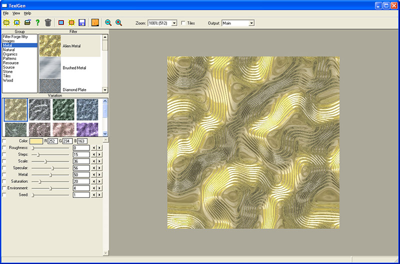
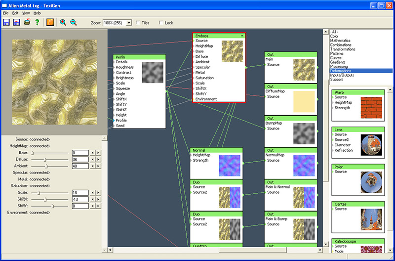
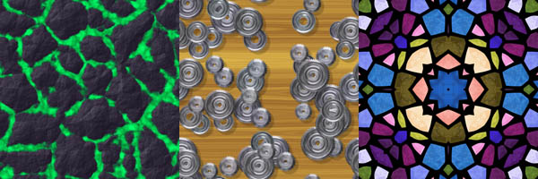

TexGen v1.19 - Texture Generator
(c) 2015 Miroslav Nemecek

project: www.breatharian.eu/TexiGen

www: https://www.breatharian.eu/Panda38

email: Panda38@seznam.cz

GitHub: https://github.com/Panda381/TexiGen

Description of the TexiGen Application
--------------------------------------
The TexiGen application is used to generate textures and illustrations using filters. Filters perform simple or more complex mathematical operations on an image. Each filter has one output and may have several inputs. The inputs are used both to feed image data into the filter and to control the filter's behavior.

Connecting filters into a tree structure creates a filter graph, or generator. Each generator produces a specific type of graphic image - for example, a wood grain generator or a landscape generator. A generator is created in a visual environment by connecting filters using links. The generator is saved as a simple text file, making it easy to edit the generator in text form, such as using an automated script.

Generators may have a set of parameters at their input that can be used to control the generator's behavior. Individual generator parameter settings can be saved as so-called "Variants." A variant represents the definition of a specific generator setting; for example, a wood generator might have variants such as dark wood, light wood, and wood with specific growth ring patterns.

Image generation (or rendering) is performed using the backward ray tracing method, starting from the selected output filter and proceeding backward toward the initial input filters. Each filter receives a request from the next filter connected to its output, asking, "Provide me with the image color at these X and Y coordinates." All filter inputs use coordinate-dependent values. This makes it possible to control filter inputs not only with constant values but also with other filters that model a specific pattern. This allows for specific effects. For example, connecting a noise generator to the input of the image shift filter can make the image appear grainy.

Another consequence of the image back-generation method is that only those branches of the filter graph that contribute to the output image are processed. An inactive branch is not processed at all and therefore does not slow down image rendering.

Directory Structure
-------------------
bin .... the TexiGen program with pre-configured sample generators
help ... online help in Czech language
src .... source codes for the TexiGen application for MSVC 2005 compiler
www .... information and a sample gallery

License Terms
-------------
The TexiGen application is freely available as FREEWARE and can be freely distributed and used for private or commercial purposes. Textures created using the TexiGen application and using generators contained in it can be sell without limitations, with one exception -  textures generated from foreign or default variant sets of generators cannot be sold, because variants are intellectual property of their authors. For selling textures it is necessary to generate your own variant set of generators. Above may not apply automatically for generators from other authors who define their own licensing conditions.

All source codes of the TexiGen program are freely available and they can be used in other private and commercial projects. In case of creation of program modification it is necessary to clearly distinguish modified version from the original version, to make it clear that it is modified version, and also state which project the modification was based on.

The TexiGen application is provided in form in which it is, with known and unknown errors. The author assumes no responsibility for any consequences arising from the use of the application, or for any consequences resulting from malfunctioning of the application.

Known Bugs and Deficiencies
---------------------------
- missing undo/redo
- missing clipboard support
- after some time of editing the sliders (and items in color selection too) disappear, the program must be restarted
- insufficient error handling when loading a generator
- image in the Blur filter is incorrectly displaced (unlike Image it is shifted left down)
- poorly functioning Emboss filter, reflections and shadows do not look realistic
- Image filter may not have the exact coordinates, the output looks different from the original
- missing scrolling mouse
- right mouse button should call local menu
- enable minimizing program during rendering (=dialog part of the window)
- display variant number (besides the Variation title)
- relative paths RelToAbsPath, AbsToRelPath, to ensure the paths were not part of the generator (generator cannot be then migrated elsewhere)
- Includes filters - in folder _Includes (it displays as filters too - they should have version in their title)
- loop - repair crash (now it is treated using Level < 100) when connecting LoopEnd output to LoobBeg Source
- blocks - Block filter could have filter graph inside it; in _Blocks folder there could be blocks (as common filters), inside block there could be included another block
- cache filter (prerender image with choosen resolution - absolute resolution or relative to output resolultion)

Versions
--------
10/14/2014 v1.00 - Lite version limited to textures 1024x1024.

10/16/2014 v1.01 - Mutation variations, work with render queue (deleting, priority, time estimation).

10/17/2014 v1.02 - Preview priority.

10/18/2014 v1.03 - Correction of filter Particle (image shift), coordinates and random filters of Particle, random filter.

10/20/2014 v1.10 - Releasing full version of the program into Freeware.

10/22/2014 v1.11 - Snowflake filter.

10/28/2014 v1.12 - Filters Percentile and Lookup.

11/04/2014 v1.13 - Generating video, repair Bevel Profile borders.

11/09/2014 v1.14 - Improve function of filters Blur, HighPass and Percentile.

01/14/2015 v1.15 - Speeded up service of input images (they load into memory - more memory requirements). Sharing pictures between render threads (reducing memory requirements). Treatment unloaded image (image can be switched off). Support input images TGA, BMP, PNG and JPG, only 24-bit RGB formats, TGA and PNG moreover 32-bit RGBA, TGA compressed format. Possibility of automatic conversion of rendered image to JPG. Inversion of locks of generator properties. F9 selects randomly input images from the specified folder.

02/05/2015 v1.16 - Filter Tussock, filter Cut, switch AlphaMod in Blend.

02/12/2015 v1.17 - Czech help and tutorials.

03/03/2015 v1.18 - Deform and Enform filters. Possibility to load and process the video using Video filter.

03/08/2015 v1.19 - Fractal filter.
